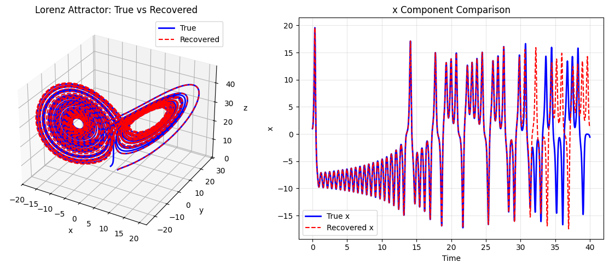
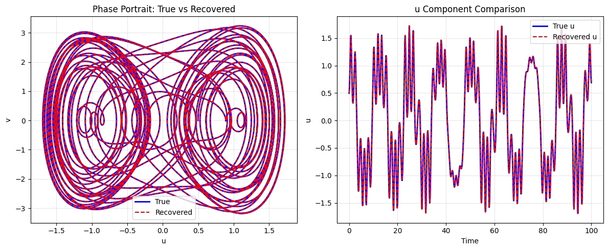
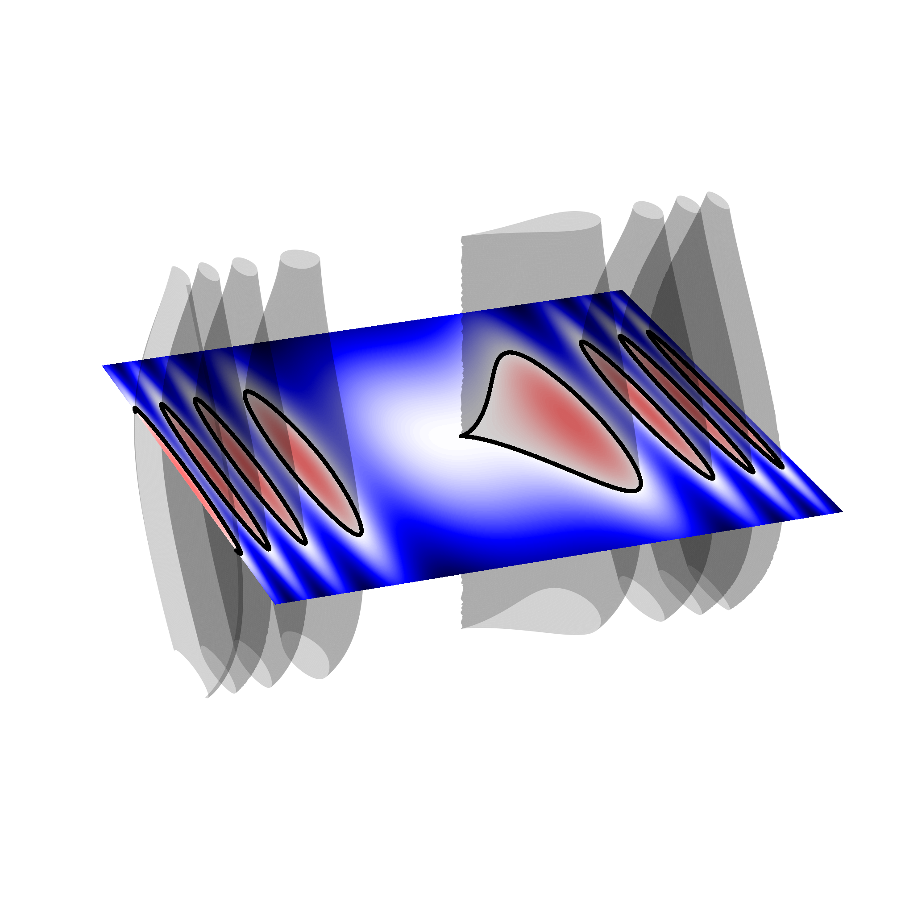

# wias — Weak Identification of Analytic Systems

`wias` is a Python library for data-driven identification of analytic systems in weak form.

## Features

- Weak-form assembly for **first- and second-order ODE** systems
- Sinusoidal test-function basis construction
- Column-pivoted QR solver (`CPQR_solver`) for coefficient recovery
- **PDE support** via optional [Firedrake](https://www.firedrakeproject.org/) integration for finite-element weak-form assembly
- Recovery of linearly-parametrized matrix families

## Examples

### Lorenz attractor

The identified model accurately reconstructs the chaotic Lorenz trajectory from noisy data.



### Duffing oscillator

The phase portrait and time series of the identified Duffing oscillator match the ground truth closely over long integration times.



More examples are available in the [`examples/`](examples/) folder, including Allen–Cahn, Navier–Stokes, and Hankel/circulant matrix problems.

### Level-set for algebraic equations

Compute zero level set of a parameter-to-recovery map to identify inputs that lie in the degenerate set and do not allow recovery of the underlying system. 




## Installation

```bash
git clone https://github.com/NBoulle/wias
cd wias
pip install .
```

### Optional: Firedrake (PDE support)

PDE identification via `wias.weak_assembly` requires [Firedrake](https://www.firedrakeproject.org/). Follow the official installation instructions at [https://www.firedrakeproject.org/install.html](https://www.firedrakeproject.org/install.html). Once installed, `assemble_weak_library_rows` becomes available automatically.


## Citing WIAS
If you use `wias` in your research, please cite the following paper:

```bibtex
@article{boulle2026zero,
  title={A zero-one law for one-shot system identification},
  author={Boull\'e, Nicolas and Halikias, Diana and Otto, Samuel E. and Townsend, Alex},
  journal={arXiv preprint arXiv:...},
  year={2026}
}
```
